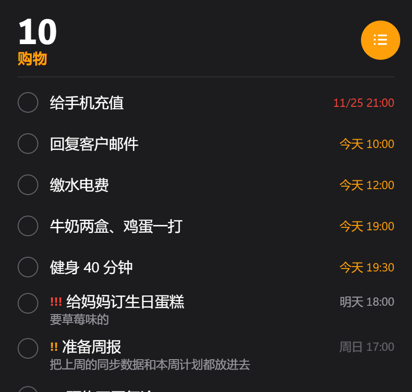

# 提醒事项小组件 · Windows 11

[](https://github.com/jianxi54/ios-reminders-widget/releases/latest)
[](LICENSE)
[](#下载安装)
[](https://github.com/jianxi54/ios-reminders-widget/actions/workflows/ci.yml)

把 iPhone 上的「提醒事项」放到 Windows 桌面：一个 420×400 的原生小窗口，无边框、20px 圆角、固定在桌面层，不挡其他窗口，按 `Win+D` 也不受影响。

读写走 Apple 的 CloudKit 私有库，和 iPhone、iPad、Mac 实时一致。改标题、拖日期、勾完成，手机下一秒就变。

<p>
  
  
</p>

---

## 下载安装

| 项目 | 要求 |
| --- | --- |
| 系统 | Windows 11，或 Windows 10 1809 及以上（x64） |
| 运行时 | WebView2（Windows 11 自带；Windows 10 缺失时安装向导会提示） |
| 权限 | 无需管理员权限，装到当前用户目录 |

1. 到 [Releases](https://github.com/jianxi54/ios-reminders-widget/releases/latest) 下载 `RemindersWidget-Setup-v0.04.exe`，双击，按向导完成（可选桌面快捷方式、开机自启）。
2. 首次启动后点右上角齿轮 → **打开浏览器登录**。
3. 在弹出的浏览器窗口里用 Apple ID 登录（含双重验证）。登录完成后窗口自动同步。
4. 想收手机推送，在设置里填 Bark 的 Key（见下文）。

> 安装包没有代码签名，首次运行 Windows 会弹「已保护你的电脑」→ 点**更多信息 → 仍要运行**。校验文件完整性：
> `Get-FileHash .\RemindersWidget-Setup-v0.04.exe -Algorithm SHA256`，与 Release 附件里的 `SHA256.txt` 对照。

卸载：Windows 设置 → 应用 → 提醒事项小组件 → 卸载；也可以直接运行安装目录里的 `Uninstall.exe`。

---

## 为什么不是 CalDAV

这是本项目最关键的一次返工。**iOS 13 / macOS Catalina 之后，苹果把「提醒事项」从 iCloud CalDAV 迁到了私有 CloudKit 库。**

在设备上点过「升级提醒事项」之后：

- CalDAV 里只剩一个带 ⚠️ 的墓碑列表，里面是苹果塞的提示条目（「在哪里可以找到我的提醒事项？」「此列表的创建者已升级这些提醒事项。」）
- 往这个列表写入在服务端会成功，但 iPhone 的「提醒事项」根本不读它 —— 看起来写成功了，实际不同步

多家厂商文档口径一致：eM Client「Apple has stopped synchronizing tasks using the standard CalDAV protocol starting with iOS 13」；BusyCal「moves its lists out of iCloud's CalDAV service」；DAVx⁵「CalDAV functionality is removed by the server」；2Do「does not share its task data through iCloud CalDAV」。

所以本项目改走 **iCloud 网页版背后的 CloudKit 私有库**，这才是能真正读写 iPhone 提醒事项的通道。

---

## 功能

**窗口**
- 420×400，无边框，20px 圆角，可拖动
- 固定到桌面层：不遮挡其他窗口、任务栏不显示、按 `Win+D` 不受影响；**固定后锁定位置**，取消固定才能拖
- 位置与固定状态记住，下次启动自动恢复
- 托盘常驻：显示 / 隐藏、固定 / 取消固定、开机自启、退出

**列表**
- 顶部大号计数 + 列表名（用列表自己的颜色），细分隔线，无 ＋ 按钮，无分组
- 行高 42px，全界面无滚动条，滚轮自然滚动
- 优先级在标题前：`!!!` 高（红）、`!!` 中（橙）、`!` 低（灰）
- 备注在标题下显示两行摘要，点其他位置打开详情
- 日期按 iOS 习惯显示：今天 / 明天 / 周三 + 时间；已完成视图也显示日期

**编辑**
- 点末尾空白行新建，回车保存
- 点标题就地改名，输入框无边框
- 点条目其余位置打开详情：标题、备注（多行）、日期、时间、全天、提前提醒、优先级、旗标、删除
- 提前提醒用 iOS 标准选项：准时 / 5 分钟 / 30 分钟 / 1 小时 / 1 天 / 2 天 / 1 周 / 自定义

**外观**
- 明暗双主题，设置里切换，窗口底色同步，重启保持，启动不闪色
- 所有下拉为自绘，暗色下不会白底白字

**同步与推送**
- 每 20 秒自动同步，窗口聚焦立即同步，也可手动刷新
- iCloud 会话失效时，重新登录后自动重连，不用重启
- Bark 推送到 iPhone，在「到期时间 − 提前提醒」那一刻发出，去重记录落盘，重启不重复推

---

## 数据与隐私

这一点值得单独说明，因为它要动你的 Apple 账号。

- **密码不经过本程序。** 登录在系统浏览器里完成，程序只在你登录成功后从浏览器读出 Cookie，换取 iCloud 访问令牌。它看不到、也不保存你的 Apple ID 密码。
- **没有中间服务器。** 所有请求从 `127.0.0.1` 直接发往 Apple 的 CloudKit 接口，不经过任何第三方。
- **本地只存三样东西**，都在 `%LOCALAPPDATA%\RemindersWidget\`：
  - `icloud-session.json`：登录令牌，用于后续同步
  - `settings.json`：主题、固定状态、Bark 配置
  - `pushed.json`：已推送记录，用于去重
- **没有遥测。** 不上报使用数据，不加统计，不发崩溃报告。
- **开源可审计。** 包括与 CloudKit 通信的每一行。

设置里点「断开连接」可随时清除本地登录状态。

提醒一句：非官方客户端访问 iCloud，存在被 Apple 判定为异常登录的可能，极端情况需要重新验证账号。日常使用未遇到，但这是客观风险，用前请知悉。

---

## 技术说明

数据通道：`https://pNN-ckdatabasews.icloud.com[.cn]/database/1/com.apple.reminders/production/private/records/*`，zone 为 `Reminders`。

| 记录类型 | 可查询 | 说明 |
| --- | --- | --- |
| `Lists` | 是 | `Name`（明文）、`Color`、`ReminderIDs`（JSON 数组）、`Count`、`Deleted` |
| `Reminder` | 否（not indexable） | 只能按 `recordName` lookup；`TitleDocument`、`NotesDocument`、`Completed`、`DueDate`、`AllDay`、`Flagged`、`Priority`、`Deleted`、`ResolutionTokenMap` |

几个实现要点，都是踩坑踩出来的：

- **标题**存于 `TitleDocument`：`base64(压缩(protobuf{2:protobuf{3:protobuf{2:文本}}}})`。压缩有两种：`H4sI` 开头是 gzip，`eJz` 开头是 zlib —— 只认 gzip 会把一部分记录判成「无标题」。**备注** `NotesDocument` 同构，但内容常被切成多个文本节点，只读第一个就只剩开头几个字，必须按序拼接并把 `U+2028` 还原成换行。
- **列表成员关系**由 `Lists.ReminderIDs` 维护，不会因为你新建 Reminder 而自动更新，必须手动把 UUID 追加进去，否则新条目在所有客户端都读不到。
- 更新 `Lists` 时**只能提交 `ReminderIDs`**。附带 `Count` 或 `ResolutionTokenMap` 会让服务端**静默丢弃整条更新**（返回体没有 records，changeTag 不变），看起来成功但毫无效果。新建顺序也必须先把 UUID 挂进 `ReminderIDs`，再 create Reminder。
- 删除是软删除：`Deleted=1`，同时从 `ReminderIDs` 摘除。
- **提前提醒不是 Reminder 上的字段**，而是一条记录链：`Reminder.AlarmIDs[]` → `Alarm`（含 `TriggerID`）→ `AlarmTrigger`（`DateComponentsData` = base64 的 JSON 年月日时分 + 时区）。iOS 存的是**绝对时刻**，所以「提前 N 分钟」= `DueDate − DateComponents`。
- **日期与提醒必须一次提交**：`DueDate` 变化时 iOS 会重算提醒，先写日期再单独写 `AlarmIDs`，第二次提交会被服务端丢弃。正确做法是把 `create Alarm` + `create AlarmTrigger` + `update Reminder(DueDate, AllDay, TimeZone, AlarmIDs)` 放进**同一个 modify 原子批次**。
- 创建 `Alarm` 时**不能带 `parent`**，否则 CloudKit 认为同批次里 Reminder 被更新两次，整批失败。`AlarmIDs` 要用数组提交，字符串形式的 JSON 数组会报 `Expected a list in field: AlarmIDs`。
- 清空日期用 `DueDate: {value: null}`，服务端会把该字段整个删掉。
- **备注写回是压平的**：复用标题的「压平成一个 run」逻辑，iPhone 上原有的粗体、颜色块会变成纯文本，文字内容不丢。
- **圆角**：`DWMWA_WINDOW_CORNER_RADIUS` 只有 8px/4px 两档，做不出大圆角，所以改用 `SetWindowRgn + CreateRoundRectRgn` 裁成 20px（`SetParent` 挂到桌面层后要重新应用一次）。
- **主题**：页面用 `html[data-theme]` 切一整套 CSS 变量，设置写进 `settings.json` 的 `ui.theme`。宿主启动时读这个值定窗口底色，并在页面第一帧之前注入 `data-theme`，亮色主题不会先闪一下深色。
- **登录**：Node 直接 POST `idmsa.apple.com` 会被 Apple WAF 以 503 拦截（TLS 指纹层识别，加任何请求头都无效），所以登录必须由真实浏览器完成。
- **限流**：CloudKit 对频繁 lookup 返回 `503 THROTTLED`。客户端对 `Alarm`/`AlarmTrigger` 按 id 缓存，请求间隔 260ms 并指数退避；服务端 10 秒内复用结果，有旧快照时先把旧数据给界面再后台刷新，读失败时保留旧列表而不是清空。
- **`421 Invalid global session`** 不是网络错误，是 iCloud 作废了这次登录。程序盯着会话文件的修改时间，重新登录后自动重连。

---

## 常见问题

**提示「iCloud 判定这次登录已失效」**
在设置里点「打开浏览器登录」，登录完成后最多 20 秒自动接上，不用重启。

**改了但 iPhone 上没变化**
先点刷新。写入成功后 iPhone 上下拉刷新一次。空标题、无到期日的条目在 iPhone 上会归入「无日期」。

**改了备注，原来的加粗、颜色没了**
写回时压平成纯文本，文字不丢，格式会丢。当前实现的限制。

**收不到 Bark 推送**
先在设置里点「发送测试」。收不到检查 Key 和设备是否同一服务器；收得到说明是提前提醒时间没设对。

**任务管理器里有好几个 msedgewebview2.exe**
WebView2 的正常结构（浏览器、渲染、GPU、网络等进程）。程序已开低内存模式，收进托盘时挂起渲染进程。

**端口冲突**
默认 8642，只监听 `127.0.0.1`。

---

## 从源码构建

需要 .NET SDK（编译宿主与安装器）和 Node.js 18+（运行本地服务，安装包会自带一份）。

```bat
:: 1. 编译宿主
build-host.bat

:: 2. 开发模式直接跑（用系统 Node）
start-widget.bat

:: 3. 打包安装程序 → dist\RemindersWidget-Setup-v0.04.exe
powershell -ExecutionPolicy Bypass -File packaging\build.ps1
```

打包脚本会自动：组装载荷、编译独立卸载器、压缩、编译安装器、算 SHA256，并在打包前扫描载荷里有没有密钥和本机路径。

---

## 目录结构

```
ios-reminders-widget/
├─ server.js                本地服务（127.0.0.1:8642），CloudKit 读写 + Bark 推送调度
├─ lib/
│  ├─ cloudkit.js           CloudKit 客户端：记录读写、protobuf 编解码、日期与提醒
│  ├─ settings.js           本地设置
│  ├─ bark.js               Bark 推送
│  └─ version.js            版本号（唯一来源）
├─ public/                  前端（index.html / app.js / style.css）
├─ host/                    WinForms + WebView2 原生宿主（C#，net48）
├─ packaging/
│  ├─ build.ps1             一键打包
│  ├─ setup/                安装向导（内嵌载荷）
│  └─ uninstall/            卸载器（复用安装器源码，不含载荷）
├─ assets/                  app.ico（唯一图标源）
├─ tools/                   开发与验收脚本（含 make-icon.py 生成图标）
├─ docs/                    截图
├─ .github/                 CI、Issue 表单、PR 模板
├─ CHANGELOG.md             每个版本的改动明细
├─ SPEC.md                  功能清单（只写留下来的功能）
└─ dist/                    构建产物（不提交）
```

---

## 已知限制

- 只支持单账号，默认中国区（`icloud.com.cn`）；其他区域需改 `tools/browser-login.js` 里的登录地址
- 备注写回是纯文本，富文本格式不保留
- 附件、子任务、位置提醒不支持
- 只做 x64，没有 ARM64
- 安装包未做代码签名，首次运行 SmartScreen 可能提示「更多信息 → 仍要运行」

---

## 参与贡献

问题、建议、PR 都欢迎。

- 装不上、登录失败、功能不会用 → 先看上面的[常见问题](#常见问题)，再开 [Discussion](https://github.com/jianxi54/ios-reminders-widget/discussions)
- 崩溃、同步不对、界面错位 → 用 [Bug 报告](https://github.com/jianxi54/ios-reminders-widget/issues/new?template=bug_report.yml) 表单，附诊断信息
- 想改代码 → 先读 [CONTRIBUTING.md](CONTRIBUTING.md)
- 安全漏洞 → **不要开 Issue**，按 [SECURITY.md](SECURITY.md) 走私密通道

---

## 相关文档

| 文件 | 内容 |
| --- | --- |
| [CHANGELOG.md](CHANGELOG.md) | 每个版本改了什么、为什么 |
| [SPEC.md](SPEC.md) | 功能清单（已废弃的功能也记着，避免又加回来） |
| [CONTRIBUTING.md](CONTRIBUTING.md) | 本地开发、代码约定、PR 要求 |
| [RELEASE.md](RELEASE.md) | 发版流程：定版 → 自检 → 打包 → 装机验证 → 发 Release |
| [SECURITY.md](SECURITY.md) | 威胁模型、漏洞报告渠道 |
| [THIRD-PARTY-NOTICES.txt](THIRD-PARTY-NOTICES.txt) | 第三方组件许可 |

---

## 许可

MIT License © 2026 [jianxi54](https://github.com/jianxi54)，全文见 [LICENSE](LICENSE)。第三方组件许可见 [THIRD-PARTY-NOTICES.txt](THIRD-PARTY-NOTICES.txt)。

本项目为独立第三方工具，与 Apple Inc. 无关联。「iCloud」「提醒事项」「Apple ID」是 Apple Inc. 的商标，此处仅用于说明用途。使用本程序造成的任何数据问题由使用者自行承担。
